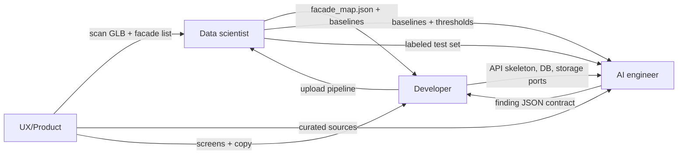

# 02 · Roles

Four people, each owns a set of modules from [03-architecture.md](03-architecture.md). Ownership means "decides and merges", not "works alone".

| Role | Owns (modules / areas) | Responsibilities | Deliverables |
|---|---|---|---|
| **AI engineer** | Agents, Verification, Stories, LLM/TTS/embedding ports | LangGraph graph, agent prompts and structured outputs, decision rules, expert-review interrupt, RAG over curated sources, story claim checking, LLM tracing and cost counter. | Working graph from photo to verified finding; story endpoint with labeled claims; prompt files under version control; hallucination comparison (Verifier on vs off). |
| **Data scientist** | Inspection (CV pipeline), evaluation, test data, region pack data | Alignment, illumination normalization, difference map, quality checks, threshold tuning; collect and label the 50-image test set; baseline photos per facade; facade corner annotations; evaluation harness and metrics. | `inspection` module with unit tests; `data/testset/` with labels; `eval/` harness printing every metric; tuned thresholds recorded in ADR-005. |
| **Developer** | API skeleton, Sites, Capture, Missions, Passport, Reports, Admin, infra, frontend build | FastAPI app and module scaffolding, DB schema and migrations, upload pipeline (validation, EXIF strip, face blur, storage), SSE status, dashboard and PWA implementation, 3D viewer integration, Docker, CI, VM + Caddy deploy. | Running stack in Docker; CI green; deployed demo URL; OpenAPI spec. |
| **UX/Product** | User journeys, UI design, Arabic content, story sources, 3D scan, pitch | Visitor and dashboard flows, RTL design tokens, Arabic copy; curate sources and oral accounts for the demo building (no invented facts); lead the building scan and Blender cleanup with the data scientist; demo script, recorded backup, pitch deck; stakeholder questions. | Figma (or equivalent) screens; `region-packs/<pack>/sources/` with citations; GLB + facade map; 3-minute demo script and recording; pitch. |

## Dependencies

Critical path: **scan → facade map → baselines → alignment → Monitor agent → pin**. If the scan is late, the developer uses a placeholder box model with the same facade IDs so nothing else waits.

Contracts agreed on day 1 morning so people can work in parallel:
1. `facade_map.json` schema (§10 of the architecture doc).
2. Finding JSON schema (Monitor output, §8).
3. Observation status events (SSE payloads, §7).
4. Story response schema (§8, Guide).

## Risks and assumptions

| Risk / assumption | Likelihood | Impact | Mitigation | Owner |
|---|---|---|---|---|
| Scan not ready or poor quality by Nov 18 | Medium | High | Two capture attempts (photogrammetry app and a splat app) on the same visit; placeholder box model with real facade IDs. | UX |
| No permission to scan/photograph the chosen site | Medium | High | Decide the building by Nov 17 noon; fallback building with owner consent. | UX |
| Visitor photos too different in angle/light for change detection | High | High | Overlay guidance, quality gate, request retake, facade-level (not point-level) claims, publish false-positive rate. | DS |
| LLM calls fail or slow during the live demo | Medium | High | Timeouts, retries, Haiku fallback, cached demo results, recorded video. | AI |
| Team overload: 4 agents + 3D + dashboard in 3 days | High | High | Agents are thin nodes over deterministic tools; cut list in [05-phases.md](05-phases.md) decided in advance. | Tech lead |
| Authorities will not pay (business) | Unknown | High (post-hackathon) | Pitch as a pilot with one authority; ask track mentors; list as an assumption. | UX |
| Visitors will not photograph for a story | Unknown | Medium | Test with 5 people during the bootcamp (friends/family at any mud-brick site). | UX |
| AGPL-3.0 license of Ultralytics YOLO | Certain if used | Medium for commercial use | Keep YOLO optional and out of Round 1 default path; review license before any commercial pilot. | AI |
