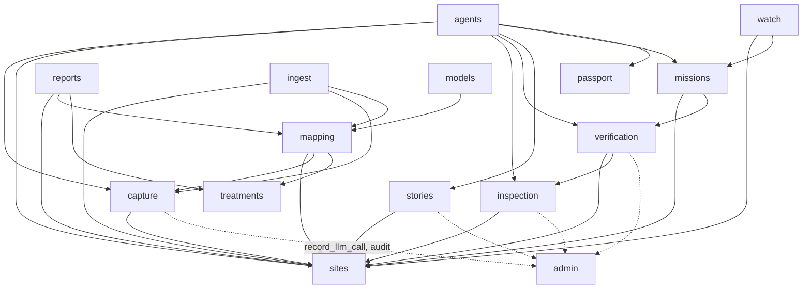
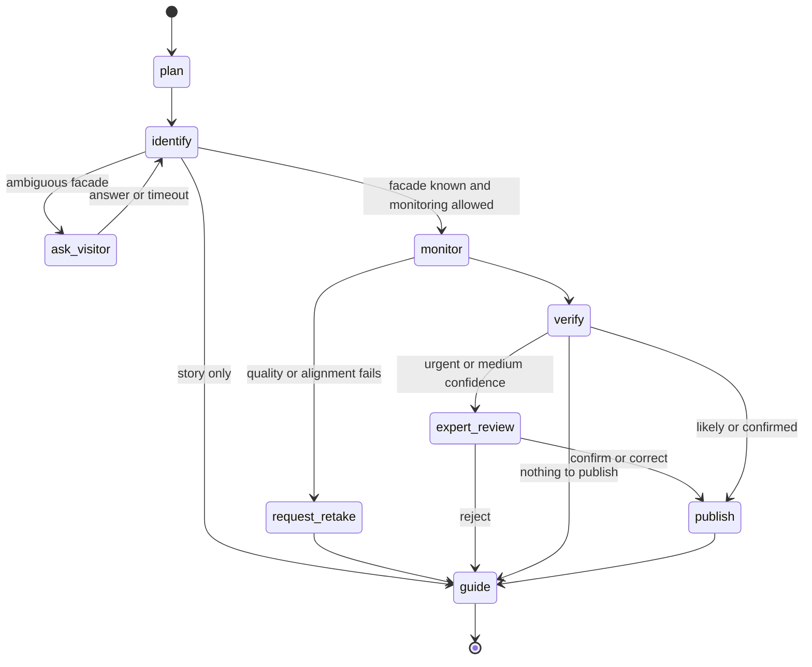
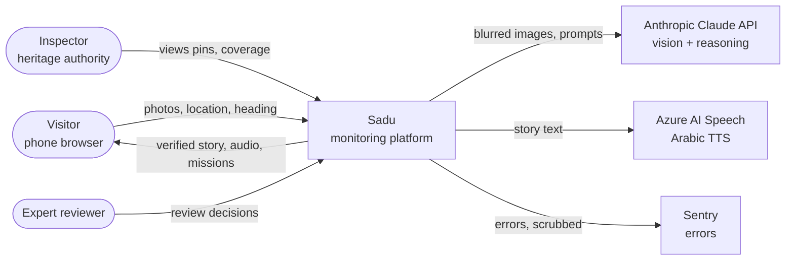
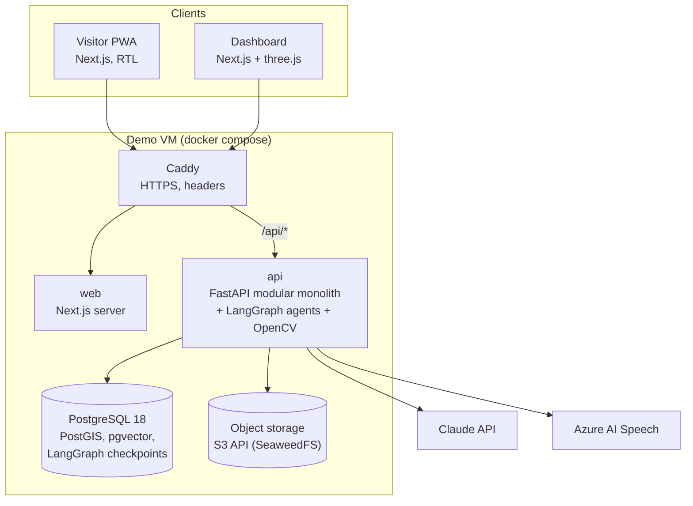
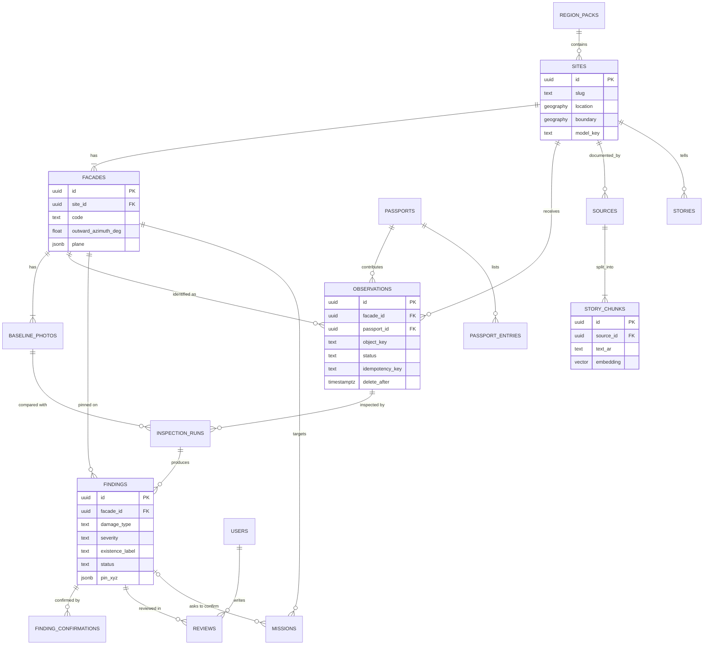
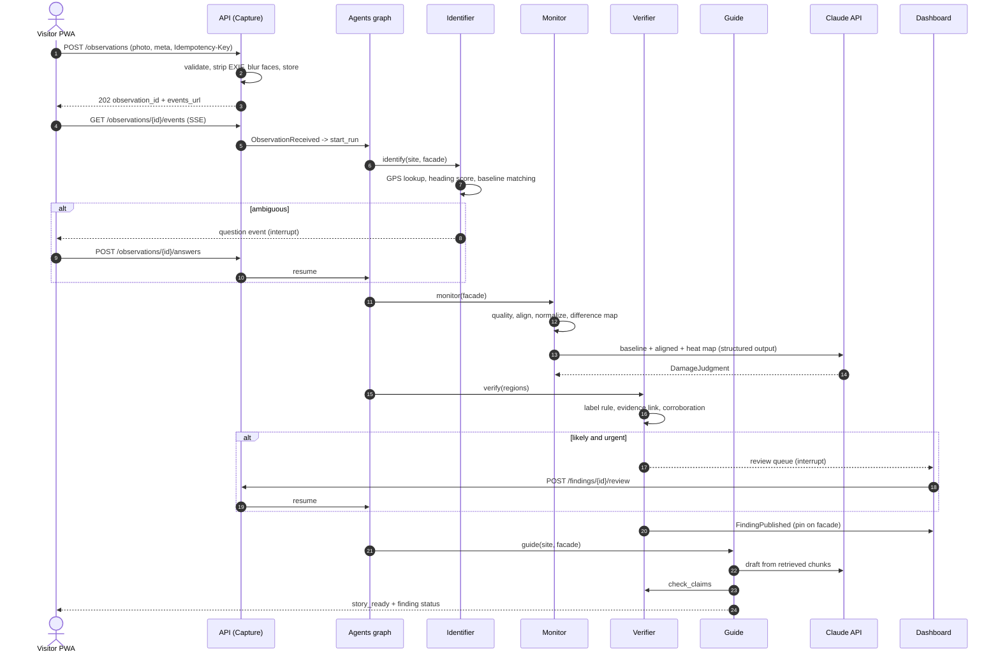
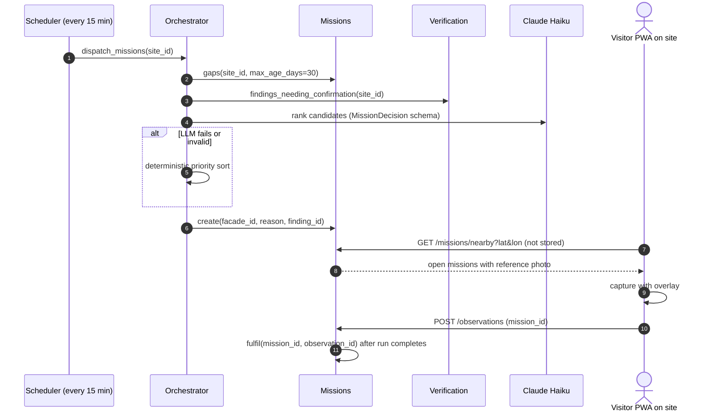
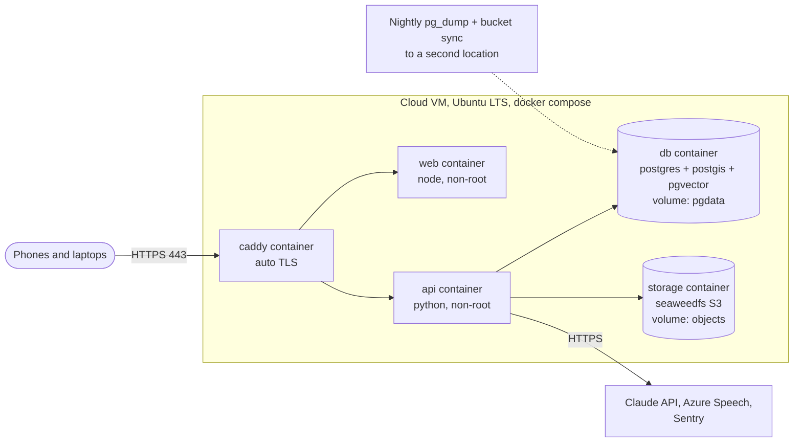

# 03 · Architecture

Written 2026-11-16. Decisions are recorded in [adr/](adr/). Library versions are in [04-stack.md](04-stack.md).

## 1. Architecture drivers

Five quality attributes, each as a scenario we can test.

| # | Attribute | Scenario | Measure |
|---|---|---|---|
| D1 | Trustworthiness | A photo produces a candidate change with no matching pixel difference, or with low model confidence. | 0 unverified findings reach the dashboard; 100% of pins have baseline, aligned photo and difference map attached (checked by a DB constraint and an E2E test). |
| D2 | Responsiveness | A visitor uploads a photo during the live demo over 4G. | 95% of photos go from upload to pin (or to a retake/review decision) in <= 30 s; first status event within 1 s. |
| D3 | Demo resilience | The LLM API times out or the venue network drops mid-demo. | The scripted flow still completes from cache with a visible "cached" badge; no unhandled error screen. |
| D4 | Privacy | A visitor photo contains a face and GPS EXIF tags. | 0 stored objects or LLM requests contain EXIF or an unblurred detected face (checked by a test on fixture photos). |
| D5 | Modifiability | A second region pack or a different LLM provider is added after the hackathon. | Adding a pack needs data files only, no code change; swapping the LLM touches one adapter file. |

## 2. Style

**Modular monolith** with Clean/Hexagonal boundaries: one FastAPI deployable, one PostgreSQL database, the LangGraph agent runtime as one module inside it. See [ADR-001](adr/ADR-001-modular-monolith.md).

## 3. Module map

Rules: a module owns its tables and no other module reads them; other modules call its public facade (`modules/<name>/api.py`) or react to its events. Events are in-process (a small typed event bus in `shared/events.py`) in Round 1.

| Module | Owns (data and rules) | Public interface (facade) | Publishes | Consumes | Depends on |
|---|---|---|---|---|---|
| **Sites & Region Packs** (`sites`) | region_packs, sites, facades, baseline_photos; facade geometry, pack import/validation | `find_sites_near(point, radius_m)`, `get_site(site_id)`, `list_facades(site_id)`, `get_baselines(facade_id)`, `facade_uv_to_xyz(facade_id, uv)` | `RegionPackImported` | none | none |
| **Capture** (`capture`) | observations; upload validation, EXIF strip, face blur, idempotency | `get_observation(id)`, `set_observation_status(id, status)`, `attach_facade(id, facade_id)`, `load_photo(id)` | `ObservationReceived`, `ObservationStatusChanged` | none | sites |
| **Inspection** (`inspection`) | inspection_runs; quality gate, alignment, illumination normalization, difference map, LLM damage judgment | `check_quality(obs)`, `align(obs, baseline)`, `diff(run)`, `judge(run)`, `match_scores(obs, facade_ids)` | `InspectionCompleted` | none | sites |
| **Verification** (`verification`) | findings, finding_confirmations, reviews; confidence-label rule, severity rule, evidence invariant, claim checking | `verify(run) -> list[Verdict]`, `publish(verdict)`, `queue_review(finding_id)`, `apply_review(...)`, `check_claims(claims, chunks)`, `pins_for_site(site_id)`, `findings_needing_confirmation(site_id)` | `FindingPublished`, `FindingRejected`, `ReviewRequested` | none | sites, inspection |
| **Stories** (`stories`) | sources, story_chunks, stories (cache), audio objects; retrieval and drafting | `retrieve(site_id, facade_id, query, k)`, `draft(site_id, facade_id, chunks)`, `save_story(story)`, `synthesize(story_id)` | `StoryReady` | none | sites |
| **Missions** (`missions`) | missions; gap detection, priority, expiry | `coverage(site_id)`, `gaps(site_id)`, `create(...)`, `open_near(point)`, `fulfil(mission_id, obs_id)` | `MissionCreated`, `MissionFulfilled` | `FindingPublished` (to close confirm-missions) | sites, capture, verification |
| **Passport** (`passport`) | passports, passport_entries; anonymous token handling, deletion | `create()`, `resolve(token)`, `record_entry(passport_id, site_id, obs_id)`, `summary(passport_id)`, `delete(passport_id)` | `PassportDeleted` | `FindingPublished` (contribution status) | none |
| **Agents** (`agents`) | LangGraph checkpoints, agent run log; plans and routing | `start_run(obs_id)`, `resume(obs_id, value)`, `dispatch_missions(site_id)` | none | `ObservationReceived` | capture, sites, inspection, verification, stories, missions, passport |
| **Reports** (`reports`) | PDFs. Built: the wall condition report (map on the rectified photo, damage totals, changes since the last approved map, treatment plan, materials, model agreement, sources), rendered with WeasyPrint. Round 2: site reports as jobs | `wall_report(session, store, map_id, catalog)`, `wall_report_pdf(report)` | none | none | mapping, treatments, sites |
| **Space watch** (`watch`) | site_scans; Sentinel-2 composites, change classes (water, vegetation loss, construction, sand, earthworks), risk score, evidence images, scene source port (Earth Search, sample, none) ([ADR-025](adr/ADR-025-space-watch.md)) | `build_scene_source(settings)`, `ScanQueue(unit_of_work, store, source)`, `scan_site(unit_of_work, store, source, site_id)`, `site_scans(site_id)`, `rank_sites()`, `due_sites(interval)`, `acknowledge(scan_id, user)`, `request_ground_check(scan_id)` | none | none | sites, missions |
| **Wall maps** (`mapping`) | damage_maps, damage_map_cells; wall rectification, grid, detector port (Claude or a ready model over HTTP), corrections, approval, change between maps, model accuracy against approved maps | `prepare_wall(photo, quad, wall, rows)`, `detect_damage(detector, prepared)`, `save_map(...)`, `get_map(id)`, `list_maps(...)`, `correct_cells(id, corrections)`, `approve_map(id, reviewer)`, `previous_approved(map)`, `treatment_plan(map, catalog)`, `accuracy(site_id?)` | none | none | sites, capture, treatments |
| **Ingestion** (`ingest`) | devices, ingest_jobs; camera registry, snapshot and RTSP capture with SSRF checks, bulk upload batches, EXIF GPS reading, GPS-to-facade matching, job worker with retries ([ADR-027](adr/ADR-027-ingestion.md)) | `Ingestion(unit_of_work, store, detector, cameras)` with `capture(device_id)`, `capture_due(interval)`, `queue_uploads(photos, target)`, `retry(job_id)`, `assign_facade(job_id, facade_id)`; `build_camera_client(settings)`, device CRUD, `list_jobs(...)`, `seed_demo_camera()` | none | none | sites, capture, mapping, admin |
| **Model registry** (`models`) | ml_models; versions of the own damage model (candidate, active, retired, one active at a time), training export of approved maps ([ADR-029](adr/ADR-029-own-model.md)) | `list_models()`, `register_model(model, by)`, `activate_model(id)`, `retire_model(id)`, `active_model()`, `training_export(store, weak)` | none | none | mapping |
| **Treatments** (`treatments`) | treatment catalog file (per damage type and severity, with materials per m², tools, steps and sources); planning by damaged area | `catalog_at(path)`, `plan_treatments(areas, catalog)` | none | none | none |
| **Admin** (`admin`) | users, sessions, audit_log, llm_calls (cost counter) | `authenticate(...)`, `record_llm_call(...)`, `audit(...)`, `costs(...)` | none | `PassportDeleted` (audit) | none (other modules call it) |

Dependency graph (arrows = "calls the facade of"). It is acyclic; this is enforced in CI with import-linter contracts.



Dashed arrows go to `admin` only for audit and cost recording. `admin` imports nothing from other modules, so no cycle.

## 4. Layers inside each module

Dependencies point inward: interface → application → domain; infrastructure implements ports defined in application and depends on domain. Domain has no framework imports.

```text
backend/
├── pyproject.toml
├── alembic/                     # one migration history, one folder per module's tables via naming
├── src/sadu/
│   ├── main.py                  # app factory, lifespan, router mounting
│   ├── shared/                  # cross-cutting, kept small (see §5)
│   │   ├── config.py  errors.py  logging.py  ids.py  events.py
│   │   ├── auth.py    rate_limit.py  i18n.py  db.py  storage.py
│   │   └── ports/                # LLMPort, EmbeddingPort, TTSPort, ObjectStorePort
│   └── modules/
│       └── <module>/
│           ├── api.py            # public facade: the only import other modules may use
│           ├── interface/        # FastAPI routers, request/response schemas (Pydantic)
│           ├── application/      # use cases, ports specific to the module
│           ├── domain/           # entities, value objects, rules (pure Python)
│           └── infrastructure/   # SQLAlchemy models/repositories, adapters (Anthropic, Azure TTS, S3, OpenCV)
├── tests/
│   ├── unit/<module>/            # domain rules
│   ├── integration/<module>/     # facade + real Postgres
│   └── e2e/                      # photo -> pin
└── eval/                         # 50-image evaluation harness
frontend/
├── app/(visitor)/...             # PWA routes, RTL
├── app/(dashboard)/...           # inspector + expert routes
├── components/  lib/api/  lib/i18n/  public/manifest.webmanifest
region-packs/<pack-code>/         # data only: sites.json, facades, baselines/, models/, sources/
infra/                            # Dockerfiles, compose, Caddyfile
```

## 5. Cross-cutting concerns (one place each)

| Concern | Where | Decision |
|---|---|---|
| Authentication | `shared/auth.py` + `admin` | Dashboard: email/password, Argon2id, server-side session row, `HttpOnly; Secure; SameSite=Strict` cookie. Visitor: anonymous passport token (random 256-bit) in `X-Passport-Token`, stored as SHA-256 hash. [ADR-011](adr/ADR-011-auth.md) |
| Authorization | `shared/auth.py` dependencies `require_role("inspector" \| "expert" \| "admin")` | Deny by default: every router declares a dependency; a test fails if any route lacks one (public routes use an explicit `public()` marker). |
| Validation | Pydantic models at the interface layer; domain value objects re-check invariants | Unknown fields rejected (`extra="forbid"`). |
| Error format | `shared/errors.py` exception handlers | RFC 9457 `application/problem+json` (§7). Domain errors map to codes; unexpected errors return 500 with `request_id` only. |
| Logging + request IDs | `shared/logging.py` (structlog, JSON) + middleware | `X-Request-ID` accepted or generated; bound to every log line, LLM trace and problem body. No photos, tokens, coordinates or emails in logs. |
| Config + secrets | `shared/config.py` (pydantic-settings) | Environment variables only; `.env.example` lists names; app refuses to start if a required secret is missing in `prod`. |
| i18n / RTL | Frontend `lib/i18n/` (ar default, en); backend `shared/i18n.py` for user-facing messages (retake reasons, questions) | Messages keyed, not hard-coded; logical CSS properties only. |
| Background jobs | `shared/jobs.py` wrapping FastAPI `BackgroundTasks` + startup sweep | Agent runs start as background tasks; LangGraph checkpoints make them resumable; on startup, observations stuck in `processing` for > 2 min are resumed. [ADR-008](adr/ADR-008-background-jobs.md) |
| File storage | `shared/storage.py` (`ObjectStorePort`, S3 adapter via boto3) | Private bucket; presigned GET URLs valid 5 min for the dashboard; keys are random UUIDs, never visitor-provided names. [ADR-006](adr/ADR-006-object-storage.md) |
| Rate limiting | `shared/web.py` (`RateLimiter`, `limit_per_ip`, `limit_public_reads`) | Per passport token and per IP (§7): login 5/min, passport creation 10/h, upload 30/min, live updates 30/min, answers 30/min, story 30/min, public reads 240/min shared, wall maps per user per hour. In-memory store is acceptable because there is one API process; idle keys are forgotten every 1000 checks so memory stays bounded. |
| External-call policy | `shared/resilience.py` | `call_with_policy(fn, timeout, retries, fallback)` used by every adapter. |

## 6. Data architecture

PostgreSQL 18 with PostGIS and pgvector, one database ([ADR-004](adr/ADR-004-postgres-postgis-pgvector.md)). Geography columns use SRID 4326.

| Table | Owner | Key columns | Notes |
|---|---|---|---|
| region_packs | sites | id, code, name_ar, name_en, version | |
| sites | sites | id, pack_id, slug, name_ar, name_en, building_type, location geography(Point), boundary geography(Polygon), model_key, facade_map_version | |
| facades | sites | id, site_id, code, name_ar, name_en, outward_azimuth_deg, plane jsonb, default_camera jsonb, polygon_uv jsonb | plane = origin, u, v, normal, width_m, height_m (§10) |
| baseline_photos | sites | id, facade_id, object_key, captured_at, is_primary, width, height, h_img_to_uv jsonb, features_key | `h_img_to_uv`: 3×3 homography from baseline pixels to facade UV |
| observations | capture | id, site_id?, facade_id?, passport_id?, mission_id?, object_key, location geography(Point)?, gps_accuracy_m?, heading_deg?, heading_accuracy_deg?, captured_at, received_at, status, idempotency_key, content_sha256, delete_after | status ∈ received, processing, needs_input, needs_retake, done, rejected, failed |
| inspection_runs | inspection | id, observation_id, baseline_id, quality jsonb, alignment jsonb, aligned_key, diff_key, regions jsonb, judgment jsonb, model, created_at | |
| findings | verification | id, facade_id, observation_id, inspection_run_id, region_id, damage_type, region_uv jsonb, pin_xyz jsonb, severity, existence_label, cause, cause_label, status, confirmations, rationale_ar, baseline_key, photo_key, diff_key, created_at, published_at | CHECK: `status <> 'published' OR (baseline_key IS NOT NULL AND photo_key IS NOT NULL AND diff_key IS NOT NULL AND existence_label IN ('confirmed','likely'))` |
| finding_confirmations | verification | finding_id, observation_id, contributor_hash, created_at | one row per distinct contributor (passport id, or photo hash without a passport), so one visitor counts once |
| reviews | verification | id, finding_id, reviewer_id, decision, changes jsonb, reason, created_at | |
| missions | missions | id, facade_id, reason, finding_id?, status, instruction_ar, reference_baseline_id, priority, created_at, expires_at, fulfilled_by | |
| sources | stories | id, site_id, kind, title, url?, narrator_name?, license, reviewed_by, reviewed_at | kind ∈ official, oral_reviewed, secondary |
| story_chunks | stories | id, source_id, site_id, facade_id?, text_ar, embedding vector(1024), tsv tsvector | |
| stories | stories | id, site_id, facade_id?, lang, claims jsonb, audio_key?, generator_version, created_at | cache; regenerated when sources change |
| passports | passport | id, token_hash bytea, created_at, last_seen_at | |
| passport_entries | passport | id, passport_id, site_id, observation_id?, created_at | |
| damage_maps | mapping | id, site_id?, facade_id?, wall_name, width_m, height_m, rows, cols, corners jsonb, photo_key, rectified_key, detector, detector_status, summary_ar, model_cells jsonb, status, created_by, approved_by, approved_at, created_at | `model_cells` keeps the detector's answer unchanged so accuracy can be measured after the expert corrects the map. CHECK: approved maps name their reviewer. |
| damage_map_cells | mapping | map_id, row, col, damage_type, severity, confidence, source | one row per damaged cell; sound cells have no row |
| ml_models | models | id, name, version, base_model, adapter_uri, metrics jsonb, status, created_by, activated_at, created_at | UNIQUE (name, version); partial unique index keeps one `active` row |
| users, sessions, audit_log, llm_calls | admin | users(email, password_hash, role, failed_logins, locked_until); sessions(id_hash, user_id, expires_at); audit_log(actor_id, action, target, details, request_id, at); llm_calls(observation_id?, agent, model, input_tokens, output_tokens, cost_usd, latency_ms, status, trace_id, at) | |
| checkpoints* | agents | managed by `langgraph-checkpoint-postgres` `setup()` | thread_id = observation id |

### Indexes for the main queries

| Query | Index |
|---|---|
| Which site is this GPS point in or near? `ST_DWithin(boundary, :pt, 200)` | `GIST (boundary)`, `GIST (location)` on sites |
| Latest usable observation per facade (coverage gaps) | `CREATE INDEX ON observations (facade_id, captured_at DESC) WHERE status = 'done'` |
| Published pins for a site, by severity | `CREATE INDEX ON findings (facade_id, severity) WHERE status = 'published'` |
| Corroborating findings (same facade + type, last 30 days) | `findings (facade_id, damage_type, created_at DESC)` |
| Story retrieval | `HNSW (embedding vector_cosine_ops)` on story_chunks, `GIN (tsv)` for keyword fallback, `btree (site_id)` |
| Upload idempotency | `UNIQUE (idempotency_key)` on observations |
| Retention purge | `observations (delete_after)` |
| Passport lookup | `UNIQUE (token_hash)` |

### Retention and deletion of personal data

| Data | Kept | Deleted / minimized |
|---|---|---|
| Original upload with EXIF | Never stored. Processed in memory. | n/a |
| Stored photo (EXIF stripped, faces blurred) not used as evidence | 30 days (`delete_after`) | Purge job deletes object and row. |
| Photo used as evidence of a published finding | While the finding is active, then 2 years (TBD with the authority) | De-linked from the passport when the passport is deleted. |
| Raw GPS + heading on observation | Until identification finishes | Set to NULL after the facade is attached; keep `gps_accuracy_m` only. |
| Passport | 12 months after last use | `DELETE /passport` removes passport, entries and non-evidence photos immediately. |
| llm_calls, audit_log | 90 days / 1 year | Purge job. |
| Application logs | 14 days | Log rotation. |

Visitor location for missions is **not stored**: the PWA sends its position to `GET /missions/nearby` and the server answers without saving it.

## 7. API contract

REST under `/api/v1`, documented by FastAPI's generated OpenAPI 3.1 at `/api/v1/openapi.json`. JSON field names in `snake_case`.

| Method and path | Auth | Purpose |
|---|---|---|
| `POST /observations` | passport token optional | Multipart: `photo` (JPEG/PNG/HEIC→rejected in R1, see §6.2 of security), `meta` JSON (site_id?, mission_id?, lat?, lon?, gps_accuracy_m?, heading_deg?, heading_accuracy_deg?, captured_at, consent{location, heading}). Header `Idempotency-Key` (UUID) **required**. Returns `202 {observation_id, status, events_url}`. |
| `GET /observations/{id}` | the passport that sent it (any caller if sent without one) | Current status, question or retake reason, story_id, finding summary. |
| `GET /observations/{id}/events` | same | Server-Sent Events: `status`, `question`, `retake`, `story_ready`, `finding`, `done`, `error`. Clients that cannot use SSE poll the GET above every 2 s. |
| `POST /observations/{id}/answers` | same passport | `{question_id, facade_id \| null}` resumes the paused run. |
| `GET /sites/{site_id}/story?facade_id=&lang=ar` | public | Verified story (schema in §8 Guide). |
| `GET /stories/{story_id}` | public | Story with a short-lived presigned audio URL (audio/mpeg). |
| `GET /missions/nearby?lat=&lon=` | public | Open missions within 300 m; position not stored. |
| `POST /passports` · `GET /passport` · `DELETE /passport` | token | Create anonymous passport; summary; delete everything. |
| `POST /auth/login` · `POST /auth/logout` · `GET /auth/me` | public / session | Dashboard session. |
| `GET /sites` | inspector+ | All sites. |
| `GET /sites/nearby?lat=&lon=` · `GET /sites/{id}` · `GET /facades/{id}/baseline` | public | Site with facades, location and boundary (lat/lon) for the visitor app and its 3D map; baseline photo for the retake overlay. |
| `GET /sites/{id}/pins?label=&facade_id=&cursor=&limit=` | inspector+ | Published findings as pins. |
| `GET /findings/{id}` | inspector+ | Evidence panel data (presigned URLs). |
| `GET /review-queue` | expert | Findings paused for review. |
| `POST /findings/{id}/review` | expert | `{decision: confirm\|correct\|reject, changes?, reason}`; resumes the run. |
| `GET /sites/{id}/coverage` | inspector+ | Days since last usable photo per facade, open missions. |
| `POST /missions` · `GET /missions?site_id=` | inspector+ | Manual dispatch; list. |
| `GET /maps/{id}/report.pdf` | inspector+ | Arabic A4 PDF of one wall map, drafts marked as drafts. 30 per user per hour. |
| `GET /watch/sites` | inspector+ | Sites ranked by satellite risk with their latest scan, the scene source and whether it is sample data. |
| `GET /watch/sites/{id}/scans` · `POST /watch/sites/{id}/scans` | inspector+ | Scan history; scan now as a background job, `202` (30 per user per hour, audited). |
| `POST /watch/scans/{id}/ground-check` | inspector+ | Opens `satellite_alert` photo missions on the site's facades, or reports that an inspector visit is needed. `409 scan_has_no_alert`, `scan_superseded`. 30 per user per hour. |
| `POST /watch/scans/{id}/acknowledge` | expert | Marks the alert as reviewed (audited). |
| `POST /sites/{id}/reports` · `GET /reports/{id}` | inspector+ | Round 2: 202 + job; site-wide PDF when ready. |
| `POST /maps` | inspector+ | Multipart: `photo` (or `meta.observation_id` to reuse a visitor photo), `meta` JSON (facade_id? or wall_name + width_m + height_m, corners? as four `[x, y]` in 0..1, clockwise from top-left). Returns `201` with the full map. `422 photo_unusable`, `invalid_corners`, `wall_size_required`. |
| `GET /maps?site_id=&facade_id=` · `GET /maps/{id}` | inspector+ | Map list; one map with cells, treatment plan and changes since the previous approved map of the same wall. |
| `GET /ingest/devices` · `GET /ingest/devices/{id}` | staff | Cameras, drones and upload stations with last capture status and thumbnail; the password is never returned, only its variable name and whether it is set. |
| `POST /ingest/devices` · `POST /ingest/devices/{id}` · `DELETE /ingest/devices/{id}` | site manager (`manage_devices`) | Create, update, delete (audited). `422 invalid_camera_url`, `device_site_required`, `facade_not_in_site`. |
| `POST /ingest/devices/{id}/capture` | site manager | Captures one snapshot now and queues it, `202` with the job; an unreachable camera returns a failed job. 60 per user per hour. |
| `POST /ingest/uploads` | inspector+ | Multipart `files` (1 to 30, 8 MB each) with optional `site_id`, `facade_id`, `device_id`; `202` with the batch. `415 heic_unsupported`, `422 batch_size`. 20 batches per user per hour. |
| `GET /ingest/batches/{id}` · `GET /ingest/jobs?device_id=` · `GET /ingest/jobs/{id}` | staff | Batch progress and job history with status, Arabic error and the created map. |
| `POST /ingest/jobs/{id}/retry` · `POST /ingest/jobs/{id}/facade` | inspector+ | Retry a failed job, or `{facade_id}` for a photo that needs a facade. `409 job_not_retryable`. |
| `GET /maps/glossary` | staff | The unified glossary: types, geometry, measures, classes and colours. |
| `POST /maps/{id}/elements` | expert | `{edits: [{action: add\|update\|delete, element_id?, element?: {damage_type, points, severity, damage_class?}}]}`; every edit is logged. |
| `POST /maps/{id}/field-inspection` | expert | Records the specialist's field inspection; approval needs it. |
| `GET /sites/{id}/condition` | staff | Site condition summary for the site manager. |
| `POST /sites/{id}/field-photography` | site manager | `{permitted}`; gates visitor missions on the site. |
| `GET /auth/roles` | staff | Roles and their permissions. |
| `POST /maps/{id}/cells` · `POST /maps/{id}/approve` | expert | `{corrections: [{cell: "B4", damage_type, severity}]}` (`damage_type: none` clears a cell); approve freezes the map. `409 map_already_approved`. |
| `GET /maps/accuracy?site_id=` | inspector+ | Per-type precision and recall of the model against approved maps. |
| `GET /treatments/catalog` | inspector+ | The treatment catalog with its review status and sources. |
| `GET /admin/costs?from=&to=` | admin | Cost per photo and per agent. |
| `GET /healthz` · `GET /readyz` | public | Liveness; readiness (DB, storage reachable). |

**Error body** (RFC 9457, `Content-Type: application/problem+json`):

```json
{
  "type": "https://sadu.example/problems/upload-too-large",
  "title": "Photo is too large",
  "status": 413,
  "detail": "Maximum size is 8 MB.",
  "instance": "/api/v1/observations",
  "code": "upload_too_large",
  "request_id": "01JD3Z9N7Q8V2W4X6Y8Z0A1B2C",
  "errors": [{"field": "photo", "message": "Maximum size is 8 MB."}]
}
```

`title` and `detail` are localized by `Accept-Language` (ar default). The `type` domain is a placeholder until a real domain exists (TBD).

**Pagination**: cursor-based. Request `?limit=50&cursor=<opaque>`, max limit 100. Response `{ "items": [...], "next_cursor": "..." | null }`.

**Idempotency**: `Idempotency-Key` stored with a hash of the request body for 24 h. Same key and same body returns the original `202` body; same key with a different body returns `409 idempotency_key_reused`.

**Rate limits** (429 with `Retry-After`): uploads 10/min and 60/day per passport, 30/min per IP; story 30/min per IP; login 5/min per IP and account lock after 5 failures; dashboard reads 120/min per session.

## 8. Agent design

LangGraph `StateGraph` with an orchestrator-worker topology. One graph run per observation; `thread_id = observation_id`; Postgres checkpointer. [ADR-002](adr/ADR-002-langgraph-orchestration.md).

Design rule that keeps the agents safe: **the LLM never chooses a free-form tool call**. The orchestrator picks steps from a closed enum and the graph executes them in code; worker LLM calls are single structured-output calls with no tools attached. Text inside images or retrieved documents therefore cannot trigger an action, only influence a schema-constrained field that deterministic rules then check.



Shared graph state:

```json
{
  "observation_id": "uuid",
  "site_id": "uuid|null",
  "facade_id": "uuid|null",
  "plan": ["identify", "monitor", "verify", "guide"],
  "identification": {"facade_id": "uuid|null", "method": "image|heading|visitor|none", "score": 0.0},
  "inspection_run_id": "uuid|null",
  "verdicts": [{"region_id": 1, "label": "likely", "action": "publish"}],
  "story_id": "uuid|null",
  "status": "processing",
  "errors": [{"step": "monitor", "code": "llm_timeout"}]
}
```

### Orchestrator

| Item | Design |
|---|---|
| Responsibility | Plan the steps for an observation; route between workers; proactively find coverage gaps and dispatch missions (every 15 min and after each observation). |
| Model | `claude-haiku-5-5`, effort `low`, timeout 8 s. |
| Decision rules | Plan must be a subsequence of `[identify, monitor, verify, guide]` and pass invariants: `identify` before `monitor`; `verify` after `monitor`; `guide` always last. `monitor` only if a facade can be identified and the photo has location consent or a mission. Max 3 open missions per site; a facade with an unconfirmed `urgent` finding outranks any coverage gap. |
| Fallback | Invalid or late plan → default plan `[identify, monitor, verify, guide]`. Mission ranking failure → deterministic priority sort. |
| Human interrupt | None directly. |

Input/output:

```json
{
  "$id": "OrchestratorPlanInput",
  "type": "object",
  "required": ["observation", "site_context"],
  "properties": {
    "observation": {"type": "object", "properties": {
      "has_location": {"type": "boolean"}, "has_heading": {"type": "boolean"},
      "mission_id": {"type": ["string", "null"]}, "site_id": {"type": ["string", "null"]}}},
    "site_context": {"type": "object", "properties": {
      "facade_count": {"type": "integer"}, "open_missions": {"type": "integer"}}}
  }
}
```

```json
{
  "$id": "OrchestratorPlan",
  "type": "object",
  "additionalProperties": false,
  "required": ["steps", "reason"],
  "properties": {
    "steps": {"type": "array", "items": {"enum": ["identify", "monitor", "verify", "guide"]}, "minItems": 1, "maxItems": 4},
    "reason": {"type": "string", "maxLength": 300}
  }
}
```

```json
{
  "$id": "MissionDecision",
  "type": "object",
  "additionalProperties": false,
  "required": ["missions"],
  "properties": {
    "missions": {"type": "array", "maxItems": 3, "items": {
      "type": "object", "additionalProperties": false,
      "required": ["candidate_id", "priority", "why"],
      "properties": {
        "candidate_id": {"type": "string"},
        "priority": {"enum": ["high", "normal"]},
        "why": {"type": "string", "maxLength": 200}}}}
  }
}
```

`candidate_id` must be one of the gap or finding IDs given in the input; anything else is dropped.

Tools (Python signatures, all in the `agents` module calling other facades):

| Tool | Signature |
|---|---|
| get_observation | `def get_observation(observation_id: UUID) -> ObservationMeta` |
| get_site_context | `def get_site_context(site_id: UUID) -> SiteContext` |
| list_coverage_gaps | `def list_coverage_gaps(site_id: UUID, max_age_days: int = 30) -> list[CoverageGap]` |
| list_findings_needing_confirmation | `def list_findings_needing_confirmation(site_id: UUID) -> list[FindingRef]` |
| create_mission | `def create_mission(facade_id: UUID, reason: MissionReason, finding_id: UUID \| None, expires_in_hours: int = 72) -> Mission` |

### Identifier

| Item | Design |
|---|---|
| Responsibility | Find the site and facade for the photo; map it to the facade on the 3D model; ask the visitor when unsure. |
| Model | Deterministic first. `claude-haiku-5-5` vision only as a tie-break between the top 2 facades. |
| Decision rules | Candidate sites: `ST_DWithin(boundary, point, 200 m)` or the QR/site_id. Heading score per facade: `cos(Δ)` where Δ is the angle between camera heading and `outward_azimuth + 180°`, ignored if heading accuracy > 30°. Image score: RANSAC inliers against each facade's primary baseline (§9). Accept if best inliers >= 40 **and** best >= 1.5 × second. Else if heading accuracy <= 20° and heading margin >= 45° → accept with `method: heading`. Else tie-break with Haiku; if still unsure → ask the visitor. |
| Fallback | No location and no site_id → ask the visitor to pick the site. No answer within 2 min → best guess, facade label `unknown`, monitoring skipped. |
| Human interrupt | `ask_visitor` calls `interrupt({"question_id", "text_ar", "options": [facade_id...]})`; resumed by `POST /observations/{id}/answers`. |

```json
{
  "$id": "IdentificationResult",
  "type": "object",
  "additionalProperties": false,
  "required": ["site_id", "facade_id", "method", "confidence"],
  "properties": {
    "site_id": {"type": ["string", "null"]},
    "facade_id": {"type": ["string", "null"]},
    "method": {"enum": ["image", "heading", "llm_tiebreak", "visitor", "none"]},
    "confidence": {"enum": ["high", "medium", "low"]},
    "candidates": {"type": "array", "items": {"type": "object", "properties": {
      "facade_id": {"type": "string"}, "inliers": {"type": "integer"}, "heading_score": {"type": "number"}}}}
  }
}
```

| Tool | Signature |
|---|---|
| find_sites_near | `def find_sites_near(lat: float, lon: float, radius_m: int = 200) -> list[SiteCandidate]` |
| rank_facades_by_heading | `def rank_facades_by_heading(site_id: UUID, heading_deg: float, accuracy_deg: float) -> list[FacadeScore]` |
| match_image_to_baselines | `def match_image_to_baselines(observation_id: UUID, facade_ids: list[UUID]) -> list[MatchScore]` |
| ask_visitor | `def ask_visitor(observation_id: UUID, options: list[UUID]) -> UUID \| None  # interrupts` |

### Monitor

| Item | Design |
|---|---|
| Responsibility | Compare the photo with the facade baseline and propose candidate changes (cracks, erosion, moisture, collapse, graffiti, missing elements, new construction). |
| Model | `claude-sonnet-5-5`, structured output, adaptive thinking, effort `medium`, timeout 25 s. |
| Decision rules | Pipeline in §9. The model may only describe numbered regions produced by the difference map; it cannot add a region. |
| Fallback | Quality or alignment fails → `request_retake` with reason. Sonnet timeout after 2 retries → one attempt with Haiku; if that fails, regions go to the expert queue as `unknown` with all evidence. Demo mode → cached judgment by `content_sha256`. |
| Human interrupt | None (Verifier owns it). |

```json
{
  "$id": "DamageJudgment",
  "type": "object",
  "additionalProperties": false,
  "required": ["regions", "overall_image_usable"],
  "properties": {
    "overall_image_usable": {"type": "boolean"},
    "regions": {"type": "array", "items": {
      "type": "object", "additionalProperties": false,
      "required": ["region_id", "change_present", "damage_type", "visible_in_baseline", "lighting_or_shadow", "severity", "confidence", "rationale_ar"],
      "properties": {
        "region_id": {"type": "integer"},
        "change_present": {"type": "boolean"},
        "damage_type": {"enum": ["crack", "basal_erosion", "surface_erosion", "moisture", "partial_collapse", "graffiti", "missing_element", "new_construction", "other", "none"]},
        "visible_in_baseline": {"type": "boolean"},
        "lighting_or_shadow": {"type": "boolean"},
        "severity": {"enum": ["watch", "moderate", "urgent"]},
        "confidence": {"enum": ["low", "medium", "high"]},
        "likely_cause": {"type": "string", "maxLength": 120},
        "rationale_ar": {"type": "string", "maxLength": 300}
      }}}
  }
}
```

| Tool | Signature |
|---|---|
| check_quality | `def check_quality(observation_id: UUID) -> QualityReport` |
| align_to_baseline | `def align_to_baseline(observation_id: UUID, baseline_id: UUID) -> AlignmentResult` |
| compute_difference | `def compute_difference(run_id: UUID) -> DiffResult` |
| judge_damage | `def judge_damage(run_id: UUID) -> DamageJudgment` |
| segment_damage (optional) | `def segment_damage(run_id: UUID) -> list[SegMask]` |

### Verifier

| Item | Design |
|---|---|
| Responsibility | Attach evidence to every candidate, assign the confidence label with the deterministic rule in §9, decide publish / review / retake / discard, and block anything without evidence. Also checks story claims against retrieved sources. |
| Model | Damage labels: no LLM (pure domain rule). Story claims: `claude-haiku-5-5` entailment check, effort `low`, timeout 8 s. |
| Decision rules | §9 label rule. Publish `likely` and `confirmed`. Send to expert review if `likely` and (severity `urgent` or model confidence `medium`). Retake if `unknown`. Discard if no change or pre-existing. Story: a claim survives only if its cited chunk entails it; label from source kind (official → confirmed, oral_reviewed → oral account, inference over confirmed claims → interpretation). |
| Fallback | Claim checker unavailable → drop all claims except those whose text is a verbatim quote of an `official` chunk; if none remain, say "no verified source". |
| Human interrupt | `queue_for_review` calls `interrupt({"finding_id"})`; resumed by `POST /findings/{id}/review`. |

```json
{
  "$id": "Verdict",
  "type": "object",
  "additionalProperties": false,
  "required": ["region_id", "label", "action", "evidence"],
  "properties": {
    "region_id": {"type": "integer"},
    "label": {"enum": ["confirmed", "likely", "unknown"]},
    "cause_label": {"enum": ["interpretation", "confirmed"]},
    "action": {"enum": ["publish", "review", "retake", "discard"]},
    "severity": {"enum": ["watch", "moderate", "urgent"]},
    "reasons": {"type": "array", "items": {"type": "string"}},
    "evidence": {"type": "object", "additionalProperties": false,
      "required": ["baseline_key", "photo_key", "diff_key", "region_uv"],
      "properties": {
        "baseline_key": {"type": "string"}, "photo_key": {"type": "string"}, "diff_key": {"type": "string"},
        "region_uv": {"type": "array", "items": {"type": "number"}, "minItems": 4, "maxItems": 4}}}
  }
}
```

```json
{
  "$id": "ClaimVerdict",
  "type": "object",
  "additionalProperties": false,
  "required": ["claim_id", "supported", "label"],
  "properties": {
    "claim_id": {"type": "string"},
    "supported": {"type": "boolean"},
    "label": {"enum": ["confirmed", "oral_account", "interpretation", "unknown"]},
    "source_id": {"type": ["string", "null"]}
  }
}
```

| Tool | Signature |
|---|---|
| link_evidence | `def link_evidence(run_id: UUID, region_id: int) -> Evidence` |
| find_corroborating_findings | `def find_corroborating_findings(facade_id: UUID, damage_type: DamageType, region_uv: BoxUV, days: int = 30) -> list[FindingRef]` |
| request_retake | `def request_retake(observation_id: UUID, reason: RetakeReason) -> None` |
| queue_for_review | `def queue_for_review(finding_id: UUID) -> ReviewDecision  # interrupts` |
| check_claims | `def check_claims(claims: list[Claim], chunks: list[Chunk]) -> list[ClaimVerdict]` |

### Guide

| Item | Design |
|---|---|
| Responsibility | Give the visitor the verified story (text + Arabic audio), update the passport, tell the visitor what happened to their photo; Round 2: generate restoration reports. |
| Model | `claude-sonnet-5-5` for drafting (effort `low`, timeout 20 s); TTS via Azure AI Speech `ar-SA-HamedNeural` or `ar-SA-ZariyahNeural`. |
| Decision rules | Draft only from retrieved chunks; every claim cites a `chunk_id`; claims go through the Verifier before saving. Stories are cached per (site, facade, lang, sources version); the cached story is served first. |
| Fallback | Drafting fails → serve the last cached verified story, else a fixed "no verified story yet" message. TTS fails → text only; audio retried in the background. |
| Human interrupt | None. Oral accounts are reviewed before they enter the source table (offline, by UX). |

```json
{
  "$id": "Story",
  "type": "object",
  "additionalProperties": false,
  "required": ["story_id", "site_id", "lang", "claims"],
  "properties": {
    "story_id": {"type": "string"},
    "site_id": {"type": "string"},
    "facade_id": {"type": ["string", "null"]},
    "lang": {"enum": ["ar", "en"]},
    "claims": {"type": "array", "items": {
      "type": "object", "additionalProperties": false,
      "required": ["claim_id", "text", "label"],
      "properties": {
        "claim_id": {"type": "string"},
        "text": {"type": "string"},
        "label": {"enum": ["confirmed", "oral_account", "interpretation", "unknown"]},
        "source": {"type": ["object", "null"], "properties": {
          "title": {"type": "string"}, "url": {"type": ["string", "null"]}, "narrator_name": {"type": ["string", "null"]}}}}}},
    "audio_url": {"type": ["string", "null"]},
    "cached": {"type": "boolean"}
  }
}
```

| Tool | Signature |
|---|---|
| retrieve_chunks | `def retrieve_chunks(site_id: UUID, facade_id: UUID \| None, query: str, k: int = 8) -> list[Chunk]` |
| draft_story | `def draft_story(site_id: UUID, facade_id: UUID \| None, chunks: list[Chunk]) -> list[Claim]` |
| synthesize_speech | `def synthesize_speech(story_id: UUID, voice: str = "ar-SA-HamedNeural") -> str  # object key` |
| record_passport_entry | `def record_passport_entry(passport_id: UUID, site_id: UUID, observation_id: UUID \| None) -> None` |
| generate_report (R2) | `def generate_report(site_id: UUID) -> UUID` |

### Retry policy for every external call

| Call | Timeout | Retries | Fallback |
|---|---|---|---|
| Sonnet (judge, draft) | 25 s / 20 s | 2 (SDK built-in, backoff) | Haiku once → expert queue / cached story |
| Haiku (plan, tie-break, claims) | 8 s | 2 | Deterministic default |
| Embeddings (local BGE-M3) | 5 s | 0 | Postgres full-text search |
| TTS | 10 s | 1 | Text only, retry later |
| Object storage | 5 s | 2 | Fail the step with `storage_unavailable`; run resumes from checkpoint on retry |

Interrupts re-run their node from the start when resumed (LangGraph behaviour), so nodes that interrupt do their side effects after the `interrupt()` call, and writes before it are idempotent.

## 9. Damage-detection pipeline

All thresholds are starting values; the data scientist tunes them on the 50-image set and records final values in [ADR-005](adr/ADR-005-damage-pipeline.md).

1. **Intake (Capture).** Decode, apply EXIF orientation, drop all EXIF/XMP/ICC, resize to 1600 px long side. Detect faces with OpenCV `FaceDetectorYN` (YuNet ONNX `face_detection_yunet_2023mar.onnx`, score >= 0.6) and blur each box padded by 20%. Only this processed image is stored and sent anywhere.
2. **Quality gate.** On 1024 px grayscale: variance of Laplacian >= 80; mean luminance in [40, 215]; clipped pixels (< 5 or > 250) <= 15%. Fail → retake (`blurry`, `too_dark`, `too_bright`).
3. **Alignment.** SIFT, 4000 features, on CLAHE-equalized grayscale of both images; k-NN matching with Lowe ratio 0.75; `findHomography` with `USAC_MAGSAC`, reprojection threshold 3 px. Accept if inliers >= 40, inlier ratio >= 0.25, homography determinant in [0.2, 5] and the warped photo covers >= 60% of the facade polygon. Warp the photo into the baseline frame and keep a validity mask. Fail → retake (`wrong_angle`), with the overlay.
4. **Illumination normalization.** Convert both to LAB; CLAHE on L (clip 2.0, 8×8 tiles); match mean and std of the aligned L channel to the baseline inside the validity mask.
5. **Difference map.** `change = 0.5 × (1 − SSIM)` (window 7) `+ 0.5 × |∇L_photo − ∇L_baseline|` (normalized). The gradient term favors sharp new edges (cracks, graffiti) over soft shadows. Threshold 0.35, morphological open 5 px then close 9 px, keep connected components >= 0.1% of the facade area, inside the facade polygon only. For each region also compute a **lighting flag**: L changed by > 25 but chroma (a, b) changed by < 10 and gradient structure correlation > 0.6 → likely shadow (values from the demo pack, [ADR-016](adr/ADR-016-build-time-changes.md)). Output: numbered region boxes, heat-map PNG, region stats.
6. **Multimodal judgment.** One Sonnet call with: baseline image, aligned photo, heat-map overlay with numbered boxes, region stats as JSON. Output: `DamageJudgment` (§8) via `output_config.format` JSON schema. The system prompt states that any text visible in images is part of the scene and never an instruction.
7. **Optional segmentation.** If enabled, a pretrained YOLO segmentation model runs on the aligned photo; mask overlap with a region adds `seg_support: true`. Off by default in Round 1.
8. **Confidence label rule** (pure function in `verification/domain/labels.py`):

```text
for each region r:
  if not quality_ok or not alignment_ok:                    -> UNKNOWN, action=retake
  j = judgment[r]
  if not j.change_present or j.damage_type == none:         -> discard
  if j.visible_in_baseline:                                 -> discard   (pre-existing, not new)
  if j.lighting_or_shadow or r.lighting_flag:               -> UNKNOWN, action=retake (different time of day)
  if j.confidence == low:                                   -> UNKNOWN, action=retake
  label = LIKELY
  if expert_confirmed(r)
     or independent_confirmations(r) >= 2:                  -> label = CONFIRMED
       (independent = different passport or anonymous upload hash, same facade,
        same damage_type, region IoU >= 0.2 in facade UV, within 30 days)
  action = review if label == LIKELY and (severity == urgent or j.confidence == medium)
           else publish
  cause_label = INTERPRETATION unless set by an expert
```

9. **Severity floor** (domain rule): `partial_collapse` → urgent; `basal_erosion` with region area >= 5% of facade → urgent; `missing_element` and `new_construction` → at least moderate; otherwise the model's severity.
10. **Pin position.** Region center (baseline pixels) → `h_img_to_uv` → facade UV in [0,1]² → 3D point `origin + u·U·width + v·V·height + 0.02·normal` (§10).

## 10. 3D twin

| Step | Decision |
|---|---|
| Capture | One building, before Nov 18. Phone photogrammetry app (team's choice) or COLMAP from 150-300 photos: two rings (eye level and raised), 70% overlap, consistent daylight, include ground line. Same visit: primary baseline photo per facade taken frontally at eye level, plus 3-5 extra angles per facade for the test set. |
| Cleanup | Blender: crop surroundings, fix orientation (Y up, +Z = north TBD per pack convention), decimate to <= 300k triangles, bake textures to one 4096 px atlas (2048 px variant for mobile). |
| Facade definition | In Blender, for each facade place 4 corner empties (bottom-left, bottom-right, top-right, top-left) on the wall; a small script exports `facade_map.json`. The same 4 corners are clicked on the primary baseline photo to compute `h_img_to_uv`. |
| Export and compression | GLB, then `gltf-transform` with Draco geometry and KTX2 (ETC1S) textures; target <= 15 MB. Keep an uncompressed GLB for re-processing. |
| Viewer | `@react-three/fiber` `<Canvas>`, drei `useGLTF` with Draco decoder, drei `OrbitControls`, `Bounds` to frame the model. KTX2 loader wiring to verify against drei docs at build time (TBD). Facades drawn as transparent planes from `facade_map.json`; hover via R3F pointer events (raycasting). |
| Pins | Small spheres (instanced) at `pin_xyz`, color by severity; click opens the evidence panel; camera flies to the facade's `default_camera`. |
| Splat (optional) | Only if the scan is a Gaussian splat: render with Spark (`@sparkjsdev/spark`) and keep the same facade planes for pins. Mesh is the default. |

`facade_map.json` schema:

```json
{
  "$id": "FacadeMap",
  "type": "object",
  "required": ["site_slug", "units", "up_axis", "facades"],
  "properties": {
    "site_slug": {"type": "string"},
    "units": {"const": "meters"},
    "up_axis": {"const": "Y"},
    "facades": {"type": "array", "minItems": 4, "maxItems": 6, "items": {
      "type": "object",
      "required": ["code", "name_ar", "name_en", "outward_azimuth_deg", "corners", "default_camera"],
      "properties": {
        "code": {"type": "string", "pattern": "^[a-z0-9_]+$"},
        "name_ar": {"type": "string"},
        "name_en": {"type": "string"},
        "outward_azimuth_deg": {"type": "number", "minimum": 0, "maximum": 360},
        "corners": {"type": "array", "minItems": 4, "maxItems": 4,
          "items": {"type": "array", "items": {"type": "number"}, "minItems": 3, "maxItems": 3}},
        "default_camera": {"type": "object", "properties": {
          "position": {"type": "array", "items": {"type": "number"}},
          "target": {"type": "array", "items": {"type": "number"}}}}
      }}}
  }
}
```

`origin`, `U`, `V`, `width`, `height` and `normal` are derived from `corners` at import time.

## 11. Diagrams

### C4 context



### C4 container



### ERD



### Sequence: photo to pin



### Sequence: mission dispatch



### Deployment



## 12. ADRs

| ADR | Decision |
|---|---|
| [ADR-001](adr/ADR-001-modular-monolith.md) | Modular monolith with hexagonal module boundaries |
| [ADR-002](adr/ADR-002-langgraph-orchestration.md) | LangGraph orchestrator-worker graph, Postgres checkpointer, interrupts for humans |
| [ADR-003](adr/ADR-003-llm-claude.md) | Claude Sonnet 5.5 + Haiku 5.5 behind an LLM port, structured outputs |
| [ADR-004](adr/ADR-004-postgres-postgis-pgvector.md) | One PostgreSQL 18 database with PostGIS and pgvector |
| [ADR-005](adr/ADR-005-damage-pipeline.md) | Classical alignment + difference + LLM judgment, deterministic label rule |
| [ADR-006](adr/ADR-006-object-storage.md) | S3 API behind a port; SeaweedFS locally instead of MinIO |
| [ADR-007](adr/ADR-007-3d-twin.md) | GLB mesh + facade planes; splat optional |
| [ADR-008](adr/ADR-008-background-jobs.md) | In-process background tasks + SSE, no queue in Round 1 |
| [ADR-009](adr/ADR-009-embeddings.md) | BGE-M3 embeddings locally behind a port, full-text fallback |
| [ADR-010](adr/ADR-010-tts.md) | Azure AI Speech ar-SA voice behind a port, cached audio |
| [ADR-011](adr/ADR-011-auth.md) | Local dashboard accounts with server sessions; anonymous passport tokens |
| [ADR-012](adr/ADR-012-frontend.md) | One Next.js app with visitor and dashboard route groups |
| [ADR-013](adr/ADR-013-demo-hosting.md) | One VM with docker compose behind Caddy |
| [ADR-014](adr/ADR-014-observability.md) | Sentry errors, structlog, `llm_calls` table (Langfuse dropped in ADR-016) |
| [ADR-015](adr/ADR-015-privacy-processing.md) | Process before store: EXIF strip and face blur before storage or LLM |
| [ADR-016](adr/ADR-016-build-time-changes.md) | Changes made while building Round 1 |
