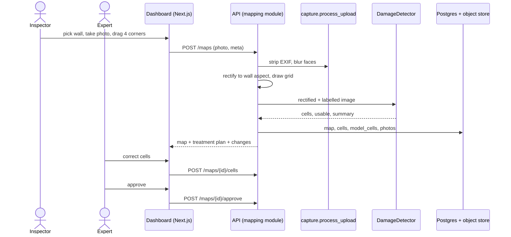

# 10 · Wall damage maps (Diriyah challenge)

Written 2026-11-18. Decisions: [ADR-017](adr/ADR-017-diriyah-challenge-alignment.md) to [ADR-021](adr/ADR-021-frontend-page-folders.md).

## What the challenge asks, and where Athar answers it

| Diriyah requirement or criterion | In Athar |
|---|---|
| Identify damage types such as cracks, plaster loss, moisture erosion | Seven wall damage types per grid cell, from Claude or a ready model ([ADR-018](adr/ADR-018-damage-detector-port.md)) |
| A specific treatment per damage type | Treatment catalog per type and severity ([ADR-020](adr/ADR-020-treatment-catalog.md)) |
| Materials and tools per treatment | Materials scaled by damaged area, tools, specialist flag, sources |
| Sensors optional | No sensor needed; a thermal image could be added later as a second input to the same port |
| Visitor behaviour on cameras out of scope | Not done; faces are blurred before anything is stored |
| Outputs from real building photos, with treatment, materials and locations | Map page: rectified wall, coloured grid, legend with m² per type, treatment plan, print to PDF |
| Accuracy against specialists | Model answer kept per map; `GET /maps/accuracy` and `eval/score_maps.py` compare it with the expert's approved map |
| One readable map with a clear colour key | Colour by type, opacity by severity, legend beside the map ([ADR-019](adr/ADR-019-rectified-grid-damage-map.md)) |
| Easy expert correction before approval | Click a cell, pick type and severity, save, approve; every change is audit-logged |
| Privacy: hide faces | YuNet face blur and EXIF strip on every upload (existing capture pipeline) |

## Flow



## Choosing the detector

Set these in `.env`; nothing else changes.

Claude (default, needs `ANTHROPIC_API_KEY`):

```bash
SADU_DAMAGE_DETECTOR=claude
```

A ready object-detection model on a Hugging Face inference endpoint, or any server that returns the same JSON:

```bash
SADU_DAMAGE_DETECTOR=http_detection
SADU_DETECTOR_URL=https://<your-endpoint>
SADU_DETECTOR_TOKEN=<token>
SADU_DETECTOR_LABELS='{"spalling": "plaster_loss", "efflorescence": "moisture"}'
SADU_DETECTOR_MIN_SCORE=0.35
```

A ready image classifier (for example a crack / no-crack patch model), called once per cell:

```bash
SADU_DAMAGE_DETECTOR=http_cell_classification
SADU_DETECTOR_URL=https://<your-endpoint>
SADU_DETECTOR_LABELS='{"Positive": "crack", "Negative": "none"}'
```

No model (the expert draws the map by hand):

```bash
SADU_DAMAGE_DETECTOR=none
```

Accepted response formats are listed in [ADR-018](adr/ADR-018-damage-detector-port.md). Check the licence of any model before using it in the pitch.

## Measuring accuracy before the demo

1. Put each wall photo and its expert labels side by side in one folder: `wall-01.jpg` and `wall-01.json`.

   ```json
   {
     "width_m": 6.0,
     "height_m": 3.0,
     "corners": [[0.08, 0.1], [0.93, 0.08], [0.95, 0.9], [0.06, 0.92]],
     "expected": {"B4": "crack", "B5": "crack", "G2": "plaster_loss"}
   }
   ```

   `corners` is optional (whole photo when missing); `rows` defaults to `SADU_MAP_ROWS`. Cells not listed are sound.
2. Run, from `backend/`, with the detector you want to test:

   ```bash
   uv run python -m eval.score_maps ../path/to/walls --min-accuracy 0.8
   ```

   It prints damaged-vs-sound agreement and precision, recall and F1 per damage type, and exits non-zero below the threshold. Claude answers are cached in `SADU_DEMO_CACHE_DIR`, so a second run costs nothing.
3. In the app, maps approved by the expert feed `GET /maps/accuracy`, shown on the maps page.

## The report

"حمّل التقرير PDF" on a map page downloads an Arabic A4 report (`GET /maps/{id}/report.pdf`, ADR-024): the wall with damage painted per cell, totals by type, changes since the last approved map, the treatment plan with materials and tools, material totals, how much of the model's proposal the expert kept, and the cited sources. A draft map and a draft treatment catalog both say so on the page.

## Demo addition (60 seconds, after the visitor part)

1. Dashboard → مخططات تلف الجدران → مخطط جديد. Pick the wall, take the photo, drag the four corners.
2. The map appears: coloured cells, legend with m² per type, summary sentence.
3. As expert, pick a brush (damage type and severity), drag across the wrong cells, undo once with Ctrl+Z to show it, save, approve.
4. Scroll to the treatment plan: steps, materials with quantities, tools, sources, and the draft warning.
5. Open the maps page: model accuracy against the expert.

## Verified on 2026-11-18

- Backend: 152 tests pass (59 new: grid, quad, corrections, changes, scoring, rectification, Claude and HTTP adapters with a mock transport, treatment catalog and plan, and the maps API end to end against PostGIS). ruff, mypy strict and the three import-linter contracts pass; the migration upgrades, downgrades and shows no drift.
- Frontend: lint (no errors), `tsc --noEmit` and `next build` pass.
- Browser run: login, new map with the corner picker, map from an HTTP detection model (a local stub returning Hugging Face style boxes), cell correction, approval, accuracy card.

Not yet verified: Claude on real wall photos, any specific ready model, and the catalog content with a conservator.
