# 11 · UML and structure

Written 2026-11-18. One diagram per question a reviewer asks. All diagrams are Mermaid and render on GitHub; CI renders them with mermaid-cli on each push.

## 1. Who uses Athar for what (use cases)

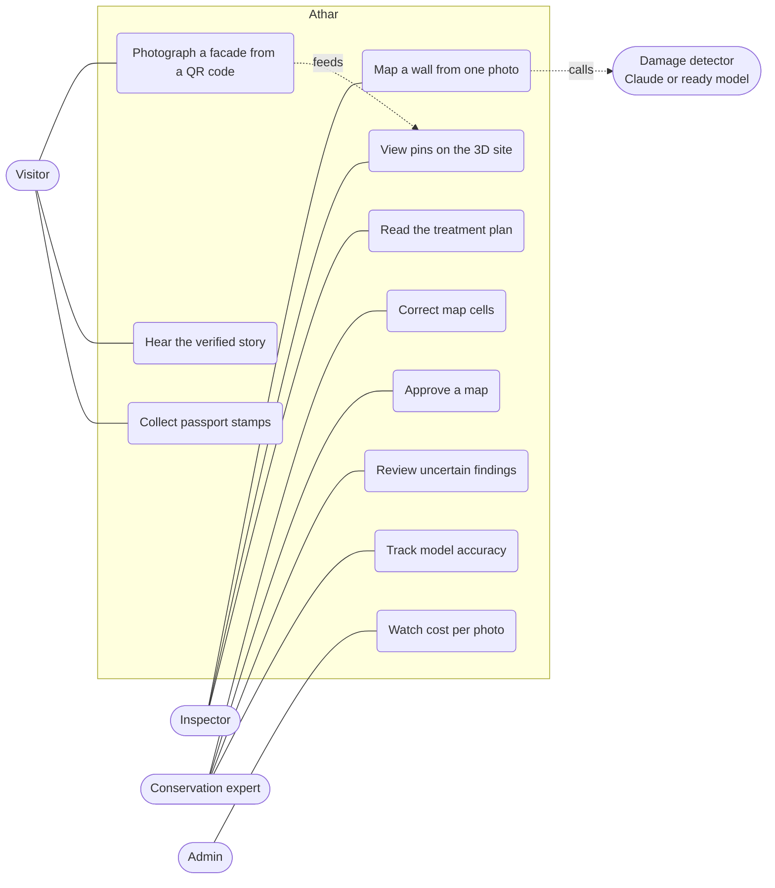

## 2. Components and the boundaries between them

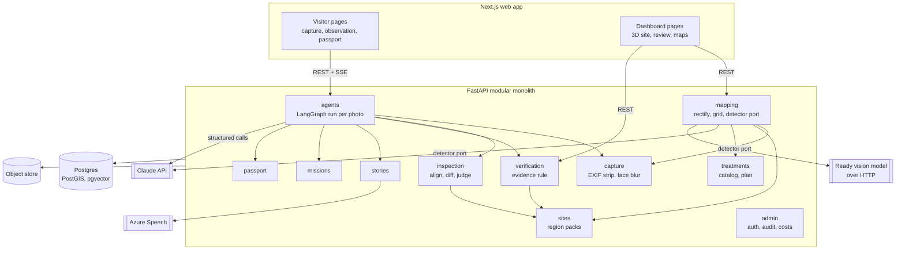

Arrows inside the API are allowed imports. import-linter fails the build on any other direction.

## 3. Domain classes of the wall map

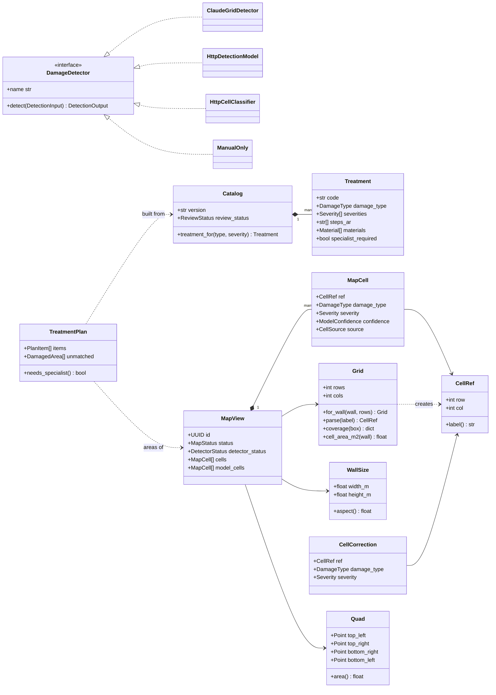

## 4. A visitor photo, end to end

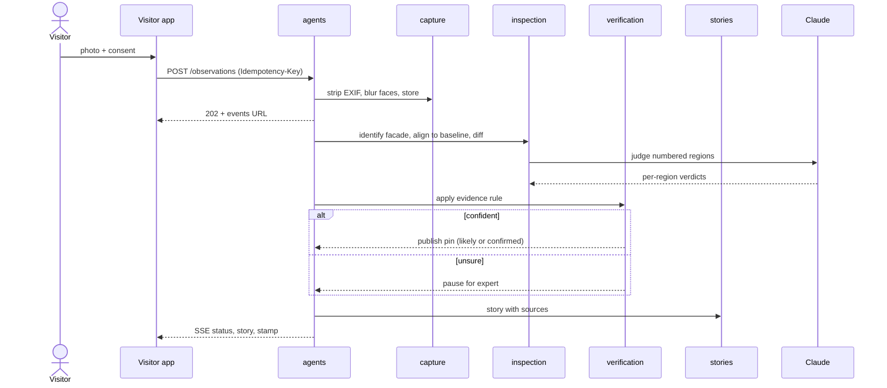

## 5. A wall map, from photo to approval

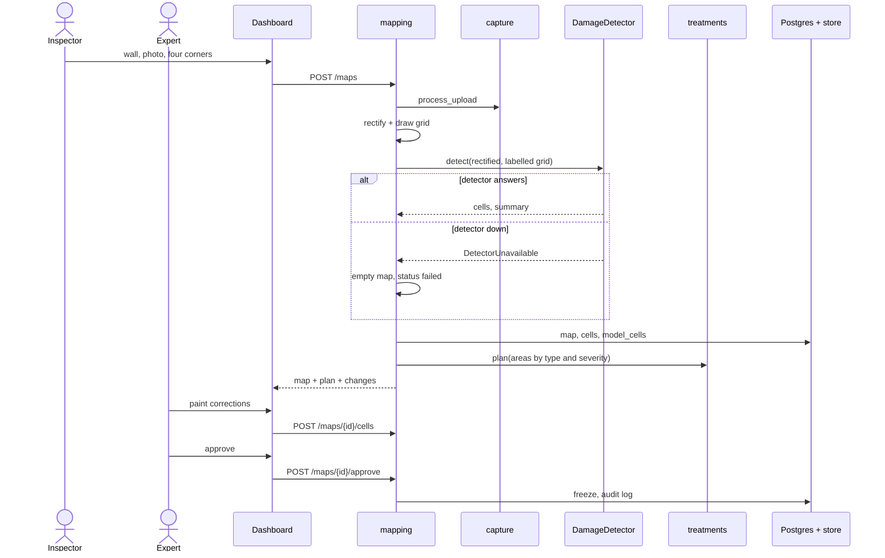

## 6. Lifecycles

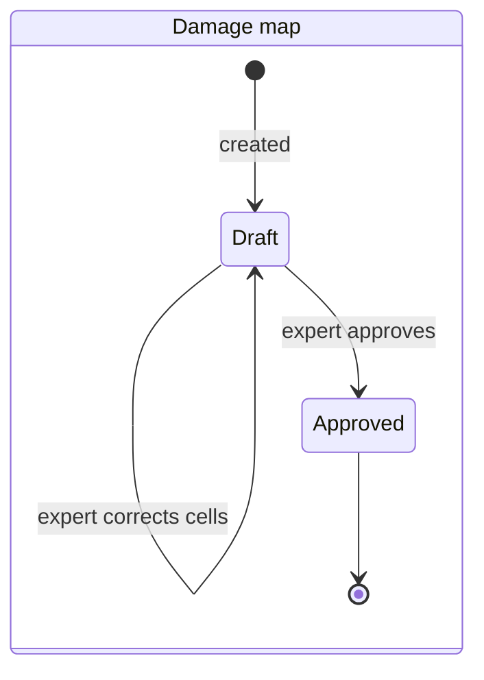

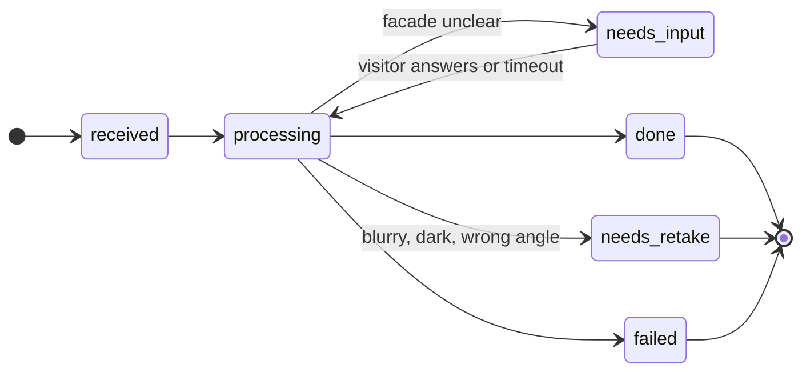

## 7. Data (wall map tables and their neighbours)

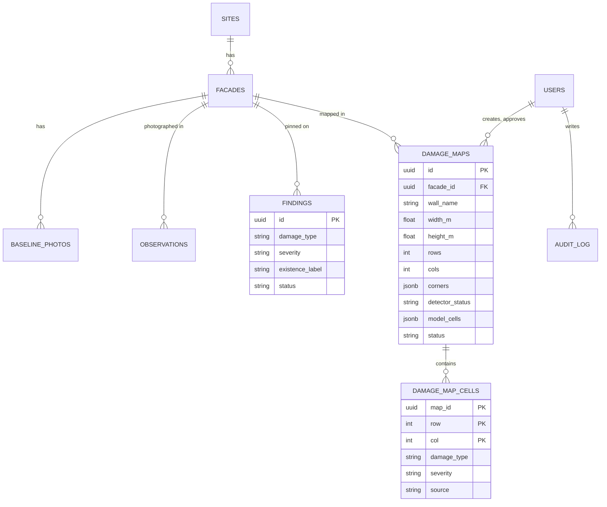

## 8. Deployment

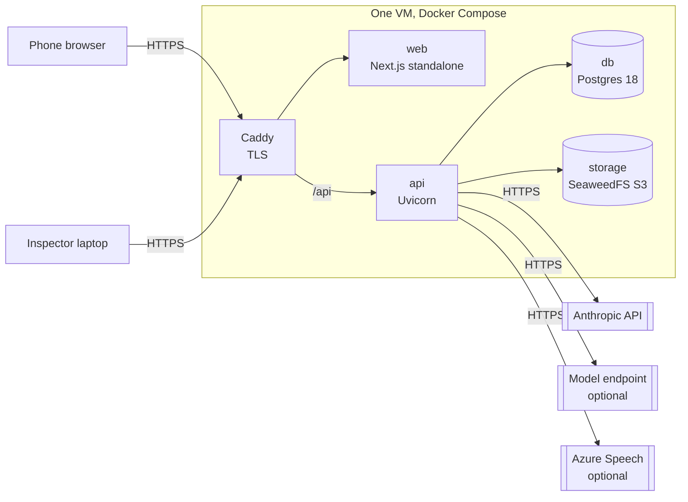

## 9. Expert review of a map (activity)

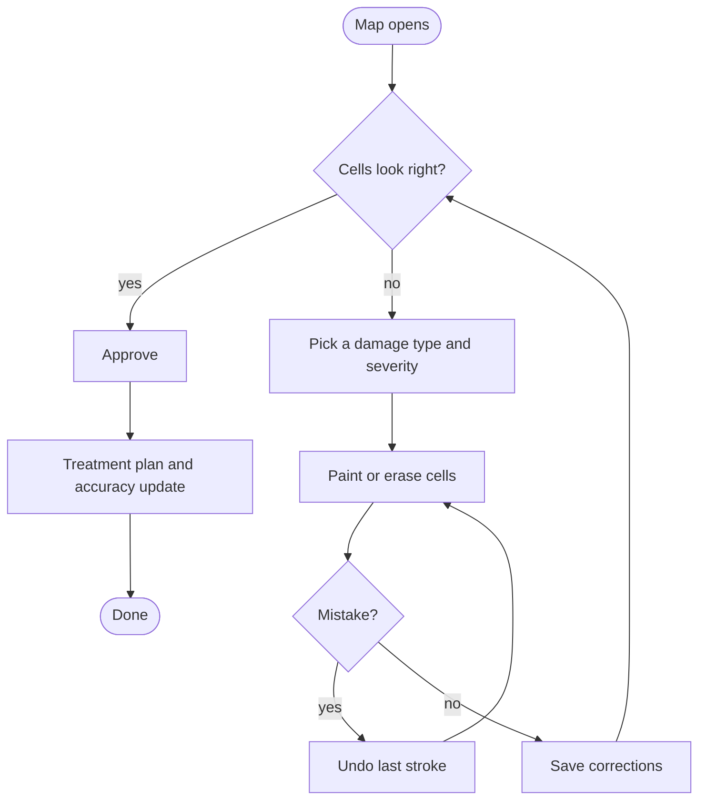

## 10. Folder structure

```
backend/src/sadu/
  main.py                    app, routers, lifespan (detector built here)
  shared/                    config, db, errors, i18n, storage, ports (llm, speech), adapters
  modules/<module>/
    api.py                   the only thing other modules import
    domain/                  pure rules, no framework imports
    application/             use cases and ports (DamageDetector lives here)
    infrastructure/          ORM, OpenCV, HTTP clients
    interface/               FastAPI routes and schemas
frontend/src/
  app/<page>/page.tsx        thin route file
  app/<page>/_components/    components only that page uses
  components/                components shared by two or more pages
  lib/                       API clients, labels, palette, hooks
region-packs/
  demo/                      sites, facades, baselines, test photos
  riyadh/                    eleven Riyadh-region heritage sites, sample satellite events
  treatments/                treatment catalog (draft)
docs/                        scope, research, architecture, ADRs, UML
```

## 11. A satellite alert, from orbit to the wall

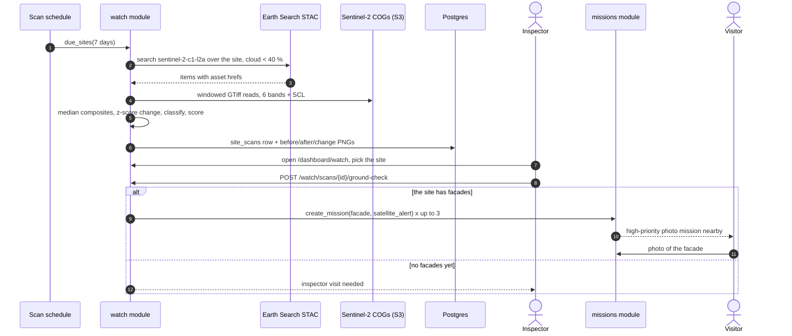
