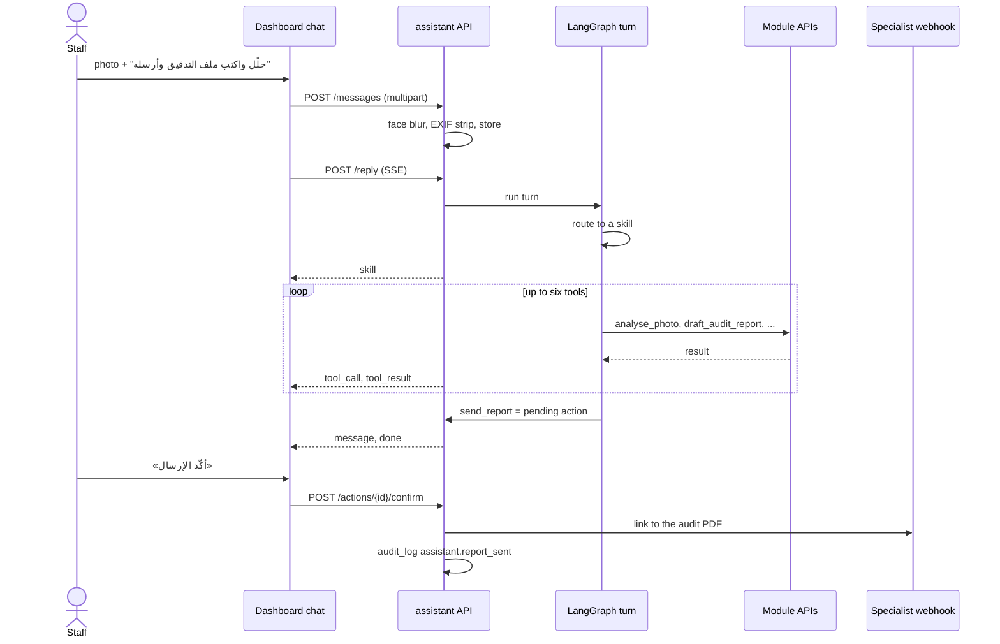

# ADR-028: «مساعد أثر», a staff chat that inspects files with skills and drafts audit files

- Status: Accepted
- Date: 2026-11-18

## Context

Staff arrive with material the dashboard does not take in one place: ground photos of a wall, drone photos of roofs and wall heads, scanned PDFs of old inspection reports, and questions about a satellite alert. They want an answer in Arabic, a damage table that uses the unified glossary, and a file they can pass to a restoration specialist. The Diriyah brief also sets hard limits: a human in the loop, no guessing, and nothing approved without the specialist and a field inspection.

Athar already has every piece of the answer: the damage detector and draft maps (`mapping`), the site condition summary (`reports`), satellite scans (`watch`), the treatment catalog (`treatments`) and the audit log (`admin`). What was missing was a conversation that picks the right procedure, calls those pieces in order and leaves a record.

## Decision

- **Module.** A new `assistant` module sits above every other module in the import-linter graph and reaches them only through their `api.py`. It owns four tables: `assistant_conversations`, `assistant_messages` (role `user`, `agent` or `tool`), `assistant_attachments` (object keys, never bytes) and `assistant_pending_actions`. Migration `d7e9f1a3b5c7`.
- **Permission.** Every route needs the `assistant` permission. Inspectors, site managers, specialists and the authority have it; model engineers do not. A conversation is visible only to its owner (others get 404). Audit files can also be downloaded by anyone with `review`, so the link sent to specialists works for them.
- **Skills are files.** Each skill is a Markdown file in `backend/src/sadu/modules/assistant/skills/` with front matter (`name`, `title`, `when`, `keywords`, `attachments`, `tools`) and three required sections: steps, checks and output schema. A test fails if a file is missing a section or names an unknown tool. The five skills are wall photo inspection, drone roof and wall head, satellite alert review, treatment check and audit report. Specialists can read and edit them without touching code.
- **Router, then planner.** A LangGraph graph runs one turn:
  1. `route`: the fast model picks a skill by name from a closed list. If the model is unavailable or refuses, a keyword router (normalised Arabic, attachment kinds) picks one instead.
  2. `think`: the main model gets the skill body as instructions and returns either one tool call or a reply, in a strict JSON schema whose tool enum holds only that skill's tools.
  3. `act`: the tool runs and its result goes back to `think`. A turn stops after six tool calls.
- **Tools** are thin calls into other modules: `analyse_photo` (mapping detector on a full-frame photo), `list_sites`, `get_map`, `get_site_condition`, `get_watch_status`, `find_treatments`, `draft_audit_report` and `send_report`.
  - `analyse_photo` saves a draft wall map only when the user named a facade and holds the `survey` permission. Otherwise it returns the elements without saving, and without metres when the wall size is unknown.
  - `draft_audit_report` renders an Arabic PDF through the reports module: findings, the analysed photos, the elements table, catalog treatments, recommendations and a «يتطلب اعتماد المختص» stamp on every page. The PDF is stored and attached to the conversation.
  - `send_report` never sends. It creates a pending action that the chat shows with «أكّد الإرسال» and «ألغِ الإرسال». Only the confirm endpoint, called by the owner, delivers the link through the specialist webhook.
- **Human in the loop.** No tool can approve a map, edit elements or approve a treatment. Every tool result is stored as a `tool` message. Side effects are written to `audit_log`: `map.create` (with `via: assistant`), `assistant.audit_report`, `assistant.report_sent` and `assistant.send_cancelled`.
- **Streaming.** `POST /assistant/conversations/{id}/reply` streams server-sent events: `skill`, `step`, `tool_call`, `tool_result` (the stored tool message), `message` (the stored reply), then `done` or `error`. A lease on the conversation (`replying_since`, three minutes) refuses a second reply while one is running and is cleared even when the client disconnects.
- **Budget and fallbacks.** The assistant uses the same `LLMPort` as the rest of the API, so the daily budget in `RecordingLLM` and the recordings in `CachedLLM` apply. When the model is down or the budget is spent, the reply says so in Arabic, and the deterministic «حلّل الصورة» button still runs `analyse_photo` directly.
- **Demo mode.** With `SADU_DEMO_MODE=true` and no model key, a `ScriptedPlanner` stands in for the model. It routes by keywords and plans from the conversation (list sites, analyse new photos, draft the file, prepare the send), so the demo and the integration tests run end to end without a network.

## Privacy

- Photos go through the capture pipeline before storage: EXIF is dropped and faces are blurred. The model never sees a raw photo; it sees ids, file names and tool results.
- PDFs are stored as uploaded, up to 10 MB, after a signature check. They are not parsed or sent to the model. The audit file lists them as references for the specialist.
- Attachments are served through the API with the owner or `review` check and `Cache-Control: private, no-store`, never through public bucket URLs.
- The webhook payload carries the file name, conversation title, the user's note and the link. It does not carry the file or any photo.

## Failure modes

| Failure | What the user sees |
|---|---|
| Model unavailable or daily budget spent | An Arabic reply saying so; the «حلّل الصورة» button still works |
| Model returns a tool outside the skill or malformed JSON | A short reply asking to rephrase; nothing runs |
| Detector down | The tool result says so and suggests manual drawing; no map is saved |
| Photo unusable | The tool result gives the retake reason from the detector |
| Planner loops | The turn stops after six tools and lists what was done |
| Client disconnects mid-reply | Finished steps stay in the conversation; the lease is released |
| Second reply while one runs | 409 `assistant_busy` |
| Confirm pressed twice | 409 `action_already_decided`; one delivery and one audit row |
| No specialist webhook configured | The send is recorded and audited with `delivered: false`, and the chat asks the user to share the file by hand |

## Alternatives

- **Free-form tool calling with the full tool list.** Simpler, but the model could reach `send_report` from any skill and the order of steps would drift. Restricting the tool enum per skill keeps each procedure narrow.
- **Skills in the database.** Editable at runtime, but they would need their own review workflow. Files in the repo go through code review like the treatment catalog.
- **Sending on the model's decision.** Rejected. Sending a file to specialists is an action on behalf of the user, so the user confirms it with a button the model cannot press.
- **Reading PDFs with a text extractor.** No PDF parser is installed, and scanned reports would need OCR. Kept out of this change; the user summarises what matters in the chat.

## Consequences

- New skills are a Markdown file and, if needed, a tool. The router picks them up at start.
- The model's cost per turn is one fast call plus one main call per step, capped by the step limit and the daily budget.
- `SADU_SPECIALIST_WEBHOOK_URL` must be set for confirmed sends to reach anyone.
