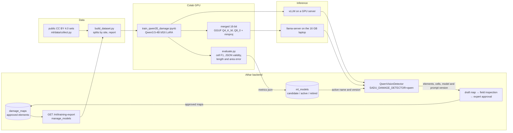

# Own damage model: data, training, evaluation, serving

How Athar's own model goes from approved maps to the map an expert opens in the morning. The decision
record is [ADR-029](../adr/ADR-029-own-model.md); the dataset card is
[ml/data/README.md](../../ml/data/README.md); serving is in [ml/serve/README.md](../../ml/serve/README.md).



## The loop

1. **Expert approval makes data.** Every approved map is a training example: the rectified photo (faces
   blurred at upload) and the expert's elements. The detector's first answer is kept in `model_cells`.
2. **Export.** A model engineer downloads the zip from `GET /api/v1/ml/training-export`. Only approved maps,
   plus draft maps as weak labels if asked; no user or visitor data. The export is audited.
3. **Build.** `python -m ml.data.build_dataset` writes chat-format JSONL, splitting by site, and a class
   balance report. Public crack and heritage-surface sets are added to training only, as their own tasks.
4. **Train on Colab.** The notebook picks the profile from GPU memory (4B on the L4 by default), trains a bf16
   LoRA, keeps the best epoch by validation loss, and steps down on out-of-memory.
5. **Evaluate.** On held-out sites: JSON validity, per-type cell precision, recall and F1 with the
   backend's own `score_maps`, length and area error, and a table against the detector that drafted those
   maps. Metrics go into the registration body.
6. **Export for inference.** Merged 16-bit weights for vLLM, GGUF Q4_K_M and Q8_0 plus the `mmproj`
   projector for llama-server on the laptop.
7. **Register and activate.** `POST /api/v1/ml/models` with the metrics; the version shows on
   `/dashboard/models`, and an engineer activates it after comparing it with the active one. One version is
   active at a time.
8. **Detect.** With `SADU_DAMAGE_DETECTOR=qwen`, each new map asks the server for the active version by name.
   Invalid JSON gets one repair request; a second failure, a timeout or an outage saves the map as `failed`
   for manual mapping. The audit entry records model, version and prompt version.
9. **Review.** Low-confidence elements block approval until the expert confirms or corrects them. The
   approved map goes back to step 1, and the accuracy card shows how the active model compares with the
   experts over time.

## Commands

```bash
python -m ml.data.export_athar --url https://athar.example --email engineer@example.org
python -m ml.data.collect list
python -m ml.data.collect organise --only rfsat_masonry
python -m ml.data.build_dataset
python -m ml.train.train --config qwen35_4b_l4
python -m ml.eval.predict --url http://127.0.0.1:8080/v1 --model athar-damage-v1
python -m ml.eval.evaluate --predictions ml/eval/predictions.jsonl
backend/.venv/bin/python -m pytest ml/tests
```

Run them from the repository root. `train.py` needs a CUDA GPU with at least 16 GB and is meant for Colab or
another 22 GB or larger GPU; the other scripts need only the Python standard library plus PyYAML, NumPy,
Pillow and SciPy, and import the backend's domain code directly from `backend/src`.

## Comparability with the product's accuracy card

The accuracy card compares the detector's cells with the expert's cells on approved maps. The evaluation
here rasterises elements onto the same grid (an area takes a cell when it covers at least 15% of it, the
same threshold as box detections; a line takes every cell it crosses; a point takes its cell) and then calls
the same `score_maps`. Ground truth is the approved elements, which are what experts edit today, so a map
whose cells were never re-painted after element edits still scores against what the expert approved.
